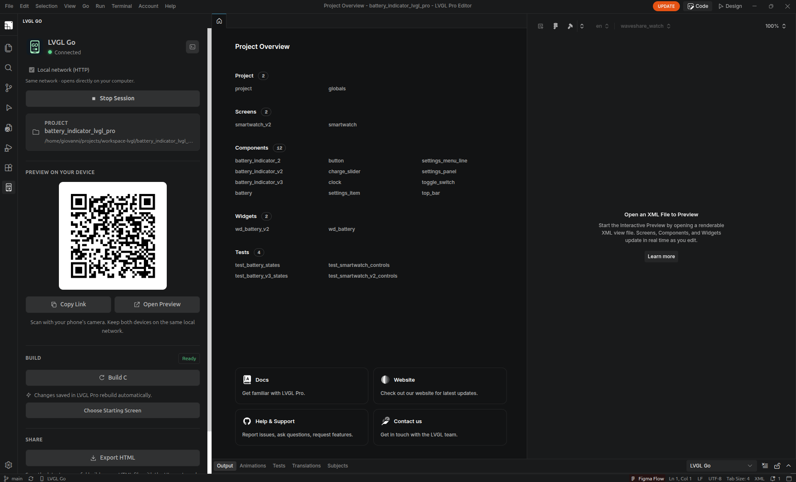

# LVGL Go


An LVGL Pro Editor extension that allows previewing an LVGL Pro UI on a phone or tablet. Start a session, the extension builds a WASM version of the UI, scan the QR code, and see updates as you work.



## Features

- Live preview updates after each successful build.
- Auto and Fit sizing, with touch and physical-keyboard input.
- Screen selection and display targets.
- Hardware frames with touch buttons that simulate device keys.
- A resizable console for UI logs and runtime errors.
- A memory chart with live allocations, peaks and a reference budget.
- A mobile app you can add to your Home Screen.
- Single-file HTML export for sharing a preview without a running session.

## Requirements

- LVGL Pro with the matching LVGL resources installed, or VS Code 1.95+ with an LVGL Pro project.
- Emscripten SDK available to the editor (`emcmake` and `emcc` on PATH).
- CMake 3.20+.

## Get started

1. Install the LVGL Go extension from its `.vsix` package.
2. Open your project in LVGL Pro or VS Code.
3. Open **LVGL Go** in the sidebar and click **Start Session**.
4. Open [LVGL Go](https://go.bauertronix.com.br/app/) on your device and scan the QR code.
5. Save changes in LVGL Pro. The preview updates after each successful build.

Keep your development computer running and connected while previewing. Your devices can use different networks. **Stop Session** ends the connection.

Startup waits for the preview address and HTTPS connection to be ready. Use **Show Output** in the dashboard to see connection status, retries and build logs. The green LED tracks the connection separately from build progress.

## Preview on a local network

Internet mode is the default. To connect directly over your LAN, check **Local network (HTTP)** before starting a session. The extension remembers your choice; stop the session before changing it.

Keep your computer and device on the same network, then scan the extension's QR code with your phone's camera or use **Open Preview**. If your computer has several LAN adapters, choose the one shared with your device. Local mode serves the app and UI from your computer, with live reload, hardware frames, console and memory monitor. Preview traffic does not need an internet connection.

Local HTTP mode runs in the browser. App installation and the browser camera scanner require HTTPS. If the device cannot connect, check the computer's firewall and whether guest Wi-Fi blocks connections between devices.

The local QR opens the preview directly. The Home button is hidden in local mode; tapping the LVGL Go title reloads the same preview.

## Install the mobile app

Add LVGL Go to your Home Screen to reuse it across projects and computers. On iPhone or iPad, use Safari’s **Share → Add to Home Screen**, then open the installed app and use **Scan QR code**.

**Auto** preserves the UI’s natural size, while **Fit** scales it to the available space. When available, use **Screen** and **Display** at the top right to switch screens and display targets.

Open the menu beside the screen picker at the top right for the **Hardware frame**, **Memory** and **Console** switches. Enabled switches use the green accent. Click the menu button again to close it.

**Console** shows UI logs and runtime errors. Drag its top handle to resize it; hide it to restore the full preview area. **Memory** shows live LVGL allocation measurements and a reference budget; on desktop, drag its heading to move it. See [Memory monitor](docs/memory.md) for what the measurements include and how to compare them with firmware.

## Share a preview

Click **Export HTML** after a successful build. Share the resulting `.html` file or put it on a static web host. It includes the compiled UI, assets, hardware frames and preview controls. Open it in a current browser; the recipient does not need an extension or a connection to your computer.

## Documentation

- [Project configuration](docs/configuration.md)
- [Hardware frames](docs/hardware-frames.md)
- [Memory monitor](docs/memory.md)
- [Standalone HTML sharing](docs/sharing.md)
- [Self-hosting the PWA](docs/hosting.md)
- [Development and packaging](docs/development.md)

## Development

```sh
npm ci
npm test
npm run package
```

The extension installer is created in `artifacts/`. To build the static PWA, run `npm run package:pwa`.

GitHub Actions tests pull requests into `main` or `master`. Pushes to those branches build both packages, available under **Build packages → Artifacts**. Pushing a matching version tag such as `v1.0.0` also publishes the `.vsix` installer and `lvgl-go-pwa.zip` as GitHub Release downloads.

See the [development guide](docs/development.md) for debugging, documentation and build output details.

## License

[MIT](LICENSE.txt). Copyright 2026 Bauertronix.
